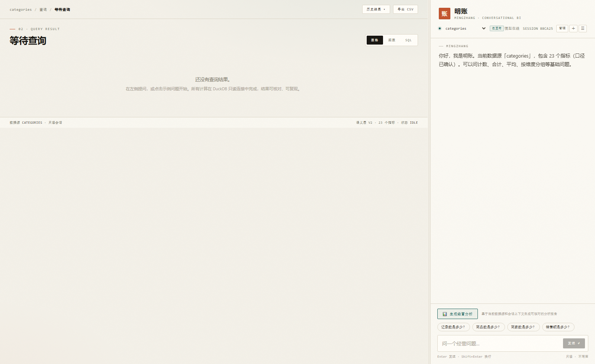
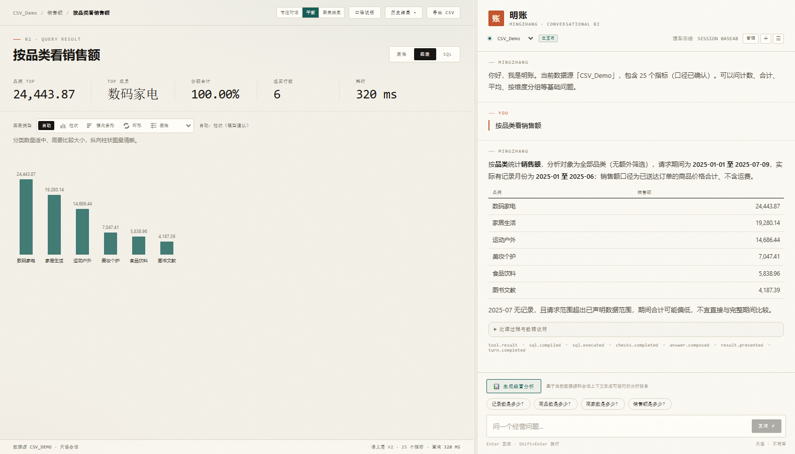
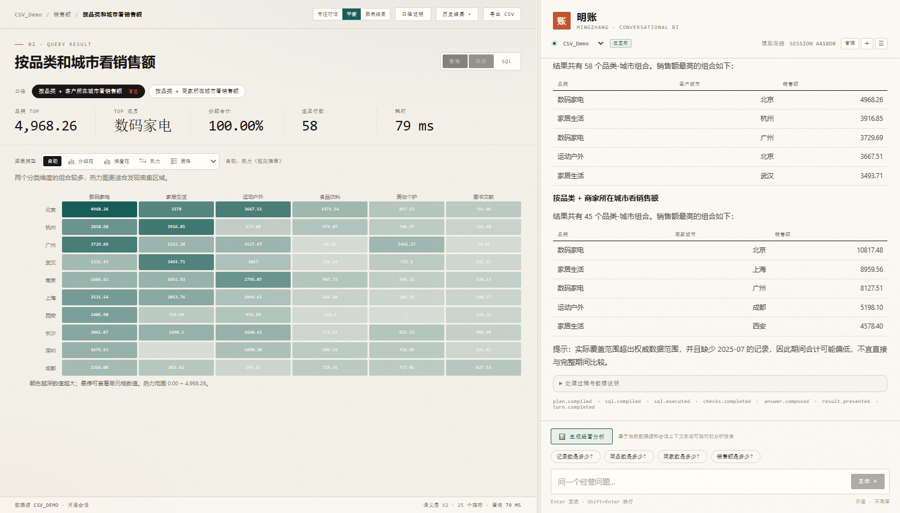
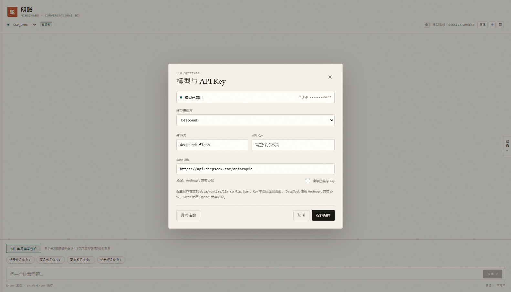
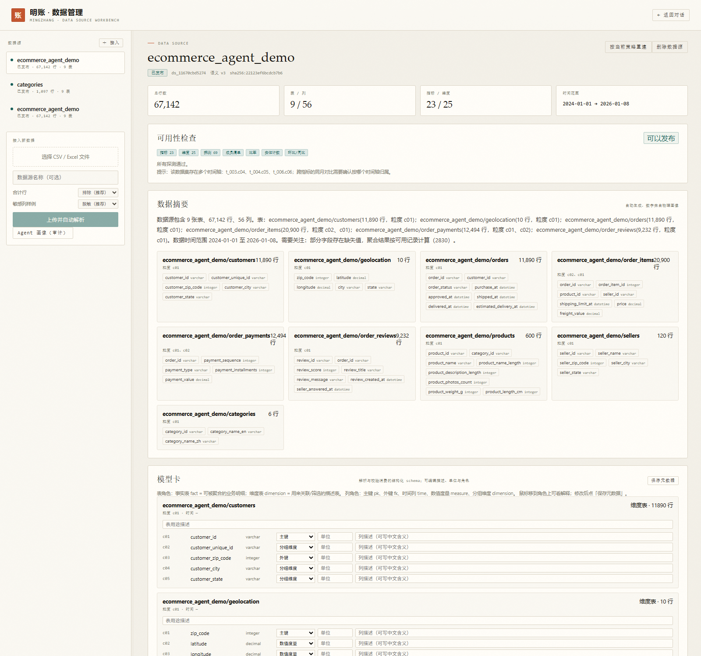

# 明账 · 对话式经营分析 Agent

明账是一个以**语义层 + 可核验 SQL**为核心的对话式 BI 项目。用户可以导入 CSV、TSV 或 Excel，系统自动识别表结构、生成待确认指标，并通过自然语言完成查询、经营分析和结果复现。

它不是“让大模型直接写 SQL”的聊天壳：模型只负责结构化解析和文字组织，SQL 由语义层、计划校验器和编译器生成，结果可回看、可复现、可追踪。



## 目录

- [核心能力](#核心能力)
- [界面预览](#界面预览)
- [部署与构建](#部署与构建)
- [第一次启动](#第一次启动)
- [界面与组件说明](#界面与组件说明)
- [模型配置](#模型配置)
- [典型使用流程](#典型使用流程)
- [配置项](#配置项)
- [API 速查](#api-速查)
- [项目结构](#项目结构)
- [测试与验证](#测试与验证)
- [故障排查](#故障排查)
- [安全与边界](#安全与边界)
- [开发约定](#开发约定)

## 核心能力

- **事件溯源状态机**：每轮对话都可回放，模型只负责结构化解析和文字组织。
- **数据集隔离**：每个数据源拥有独立的语义层、DuckDB 仓库、口径文档和运行上下文。
- **可控 SQL**：计划先校验再编译，所有值参数化，DuckDB 只读执行。
- **多问题处理**：一条消息中的多个独立问题按顺序执行，每个子问题用局部 brief 二次解析；依赖上文的子问题会注入已执行结果的维度过滤，单个问题失败不会中断整轮。
- **经营分析**：按当前数据集动态发现可用板块，生成趋势、结构、变化、履约、口碑等报告。
- **查询记录**：保存计划、SQL、参数、指纹、数据版本和校验结果，可重新执行并比较结果。
- **口径治理**：支持草稿确认、发布、版本历史、文档解析和发布就绪检查。
- **语义发布**：发布期生成实体注册表和实体计数指标；运行时优先使用已发布语义，必要时可基于已发布列构造 AVG/SUM 等派生指标（标为推断口径），模型始终不写 SQL。
- **模型卡**：发布期把 catalog / profile / semantic 合成 `model_card.json`，brief、类型校验和管理页共用这一份契约。
- **模型配置**：右上角齿轮可切换 DeepSeek（Anthropic 兼容）与 Qwen（OpenAI 兼容），填写模型名、Base URL、API Key 并测试连接；配置存本机 `data/runtime/llm_config.json`，页面只回显掩码。
- **解析上下文**：brief v2 采用 schema 优先、按问题选相关表、分段预算，不再从尾部截断。
- **结果工作台**：表格、图表、SQL 三个视图；任意维度值可筛选或下钻；口径和校验提示可折叠；图表按结果形状推荐并支持手动切换。
- **语义记忆**：每轮回答后生成 `memory.compressed`（摘要/主题/实体/未决问题/scope digest），供下一轮 parser 和 composer 使用；确定性摘要即时可用，LLM 摘要后台刷新，不阻塞回答。
- **数据质量提示**：缺失值、空列、负值、覆盖不足等问题不会阻止可计算查询，但会在答案中明确标注。
- **比率排名样本量**：比率类排名多取几行，按最小分母（`MIN_RATIO_DENOMINATOR`，默认 5）区分小样本异常值与稳定结论。
- **安全边界**：默认只监听本机；可选 `API_TOKEN` 保护全部 API 与文档；SPA 兜底路径不可越界；CSV 导出做公式注入转义；PII 列不进入模型上下文。

## 界面预览

### 查询结果与图表

左侧是结果工作台，右侧保持对话。图表使用后端 `ChartSpec` 的值列、排序、TopN、总数和单位；截断会明确提示，热力图显示单元格数值。



### 热力图

两个分类维度组合较多时，规则推荐热力图；支持在图表/表格之间切换，图表单元格可点击筛选。



### 模型配置

右上角「模型在线」左侧的齿轮打开配置弹窗。API Key 只显示掩码，保存后下一轮对话生效。



### 数据管理 / 模型卡

管理页覆盖在应用内，不跳转、不新开标签页；上传、画像、质量、关系、发布和模型卡在同一处完成。



## 部署与构建

### 环境要求

- Python **3.10+**
- Node.js **18+**（只有修改前端或重新构建 `web/dist` 时需要）
- Windows、Linux、macOS 均可；本项目示例以 Windows PowerShell 为主

### 1. 获取代码

```powershell
git clone https://github.com/wildwolf001/Calculate.git
cd Calculate
```

仓库已经包含：

- `data/datasets/ds_d7390c8574a4`：CSV_Demo 演示数据；
- `data/datasets/ds_dd0addc20f5c`：Excel_Demo 演示数据；
- `web/dist`：当前前端生产构建。

所以首次跑通不需要再导入数据，也不需要构建前端。

### 2. 创建 Python 环境

Windows PowerShell：

```powershell
python -m venv .venv
.\.venv\Scripts\Activate.ps1
python -m pip install --upgrade pip
pip install -r requirements.txt
```

如果 PowerShell 阻止激活脚本：

```powershell
Set-ExecutionPolicy -Scope Process Bypass
.\.venv\Scripts\Activate.ps1
```

Linux / macOS：

```bash
python3 -m venv .venv
source .venv/bin/activate
pip install -r requirements.txt
```

### 3. 准备配置

复制环境变量样例：

```powershell
Copy-Item .env.example .env
```

`.env` 是可选配置：

- 不填任何模型 Key：系统使用确定性规则解析和模板回答，仍可离线演示；
- 填 DeepSeek Key：可使用 Anthropic 兼容模型；
- 想用 Qwen：更推荐在页面右上角齿轮里配置，不一定要改 `.env`。

`.env`、运行时 Key 和用户数据不要提交到 Git。

### 4. 启动后端

开发模式：

```powershell
.\.venv\Scripts\python.exe -m uvicorn app.main:app --reload --host 127.0.0.1 --port 8000
```

普通启动：

```powershell
.\.venv\Scripts\python.exe -m uvicorn app.main:app --host 127.0.0.1 --port 8000
```

看到 Uvicorn 启动日志后访问：

```text
http://127.0.0.1:8000/
```

健康检查：

```powershell
curl.exe http://127.0.0.1:8000/api/health
```

预期：

```json
{"status":"ok"}
```

### 5. 前端开发模式（可选）

只有在修改前端代码时需要：

```powershell
cd web
npm install
npm run dev
```

Vite 会启动独立的开发服务器；生产模式下前端由 FastAPI 从 `web/dist` 提供。

### 6. 重新构建前端

```powershell
cd web
npm install
npm run build
```

构建后会生成：

```text
web/dist/index.html
web/dist/assets/*.js
web/dist/assets/*.css
```

后端会直接读取 `web/dist`，刷新页面即可看到新版本。

## 第一次启动

1. 打开 `http://127.0.0.1:8000/`。
2. 顶部数据源下拉框应能看到 `CSV_Demo`、`Excel_Demo`（来自仓库内置数据集）。
3. 右侧输入框可以直接问：
   - `2025年1月至6月共有多少笔已送达订单？`
   - `4月商品销售额最高的品类是什么？`
   - `按品类和城市看销售额`
4. 首次回答会经过解析、校验、编译、执行、检查和回答组织；界面会显示处理阶段与耗时。
5. 如果想使用模型，点击「模型在线」左侧的齿轮；不想配置模型也可以继续使用离线规则。

## 界面与组件说明

### 顶部导航

从左到右：

- **数据集下拉框**：切换当前数据源；切换后会话和结果显示对应数据集。
- **模型状态**：`模型在线` / `离线规则`。
- **齿轮按钮**：打开模型配置弹窗。
- **SESSION**：当前会话短 ID。
- **管理**：打开数据管理页。
- **＋**：新建对话。
- **☰**：打开历史会话抽屉。

### 左侧结果工作台

没有结果时，左栏自动收起；有结果后恢复结果视图。

包含：

- **KPI 卡片**：当前指标、TOP 成员、行数、耗时、份额等。
- **表格**：业务列名、维度筛选/下钻、行数提示、口径说明。
- **图表**：按结果形状自动推荐，也可手动切换。
- **SQL**：实际执行的 SQL、参数、指纹、耗时。
- **口径/校验**：指标定义、时间范围、粒度、质量 checks、字段映射。
- **历史结果**：查看本会话的历史结果，支持重跑验证。
- **导出 CSV**：导出当前结果。

### 图表

支持：

```text
KPI / 柱状 / 横向条形 / 折线 / 面积 / 分组柱 / 堆叠柱
环形 / 饼图 / 散点 / 热力 / 瀑布 / 表格
```

图表遵循后端 ChartSpec：

- `value`：值列；
- `sort`：`time_asc` / `value_desc` / `category_asc` / `source_order`；
- `top_n` / `total_rows` / `truncated`：截断信息；
- `unit` / `value_label` / `x_label` / `series_label`：业务标签。

前端行为：

- 不静默截断，显示“图表展示前 N 行，共 M 行”；
- 热力图单元格显示数值，hover 可看 x/y/value；
- 折线图显示 y 轴刻度、单位、x 轴标签和点 tooltip；
- 饼图把超出部分合并为“其他”，并提示零/负值；
- 图例可点击隐藏/恢复系列；
- 柱、分组、饼图、热力图可点击筛选。

### 右侧对话

- **普通提问**：自然语言问指标、时间、维度、筛选、比较。
- **连续追问**：如“那5月呢”“按城市拆一下”“该品类近几个月趋势”。
- **多问题**：一条消息可以包含多个经营问题，系统拆成子问题并逐项执行。
- **澄清**：模糊问题会先给候选范围，不会自动生成一份错误报告。
- **经营分析**：底部「生成经营分析」基于当前数据集生成可核对的报告。
- **处理过程**：可展开查看解析、校验、执行、回答各阶段。
- **字段对照**：可查看结果列与底层字段的映射。

### 数据管理

点击顶部「管理」打开，覆盖在当前页面上：

1. **上传数据源**：CSV / TSV / Excel；
2. **画像与质量**：行数、列数、类型、空值、异常、关系；
3. **指标与维度**：确认指标、时间列、维度、口径文档；
4. **发布就绪**：查看阻塞项与警告；
5. **模型卡**：编辑表/列的中文名、角色、单位、描述；
6. **Brief 预览**：查看某个问题下解析器实际看到的 schema 和字符数；
7. **发布**：生成已发布语义、实体注册表和支持粒度；
8. **删除/重建**：管理数据源生命周期。

### 模型配置弹窗

齿轮打开后：

- **模型提供方**：DeepSeek / Qwen；
- **模型名**：如 `deepseek-flash`、`qwen3.8-max-0902`；
- **Base URL**；
- **API Key**：留空表示保持已有 Key；
- **清除已保存 Key**；
- **测试连接**；
- **保存配置**。

保存后：

- 配置写入本机 `data/runtime/llm_config.json`；
- 后端重建当前数据集的 controller；
- 下一轮对话使用新模型；
- 顶部“模型在线/离线规则”同步刷新；
- 页面不会回显明文 Key。

## 模型配置

### DeepSeek

默认走 Anthropic 兼容协议：

```text
provider: deepseek
base_url: https://api.deepseek.com/anthropic
model: deepseek-v4-flash[1m]（预设）
```

也可以保留 `.env` 中的 `ANTHROPIC_BASE_URL` / `ANTHROPIC_API_KEY` / `ANTHROPIC_MODEL`，不通过页面配置。

### Qwen

走 OpenAI 兼容协议：

```text
provider: qwen
base_url: https://cn-beijing.maas.qianwenaiapi.com/compatible-mode/v1
model: qwen3.8-max-0902
api_key: 你的 DashScope / 百炼 Key
```

后端使用 `httpx` 调用：

```text
POST {base_url}/chat/completions
Authorization: Bearer <API_KEY>
```

对 Qwen 的结构化解析默认关闭 thinking，避免一个 JSON 解析先消耗几十秒推理时间。

### 不配置模型

不填 Key 时：

- `模型在线` 显示为 `离线规则`；
- 使用确定性规则解析和模板回答；
- 仍可查询基础指标、维度和时间；
- 复杂自然语言和经营分析的质量会下降。

### Key 存储与安全

- 配置保存在本机 `data/runtime/llm_config.json`；
- 文件已被 `.gitignore` 忽略；
- 备份脚本应排除 `llm_config.json`；
- API 只返回 `api_key_masked`；
- 不要把该文件发给别人，也不要提交到 Git。

## 典型使用流程

### 1. 简单查询

```text
2025年1月至6月共有多少笔已送达订单？
```

系统会：

1. 解析指标、时间、筛选；
2. 生成计划并校验；
3. 编译并执行只读 SQL；
4. 生成结果、checks、答案；
5. 写入事件日志和 memory。

### 2. 连续追问

```text
2025年4月商品销售额是多少？
那5月呢？
```

第二个问题会继承指标和范围，但替换时间；结果会分别显示 4 月/5 月口径。

### 3. 维度替换

```text
2025年4月商品销售额按品类是多少？
再按城市拆一下
```

第二个问题保持指标/时间，把维度从品类切换为城市。若“城市”本身有多种业务口径（客户城市/商家城市/地理城市），系统会列出多解释，不会静默选一个。

### 4. 复杂问题

例如：

```text
2025年上半年，销售额最高的品类是哪一个、占整体销售额多少？
这个品类里，哪些城市的哪些商品卖得最好？
再看一下这个品类近几个月的月度趋势，以及与2024年同期相比是增长还是下降。
```

系统会拆成多个子问题；无数据支撑的子问题会明确拒答，而不是编造结果。

### 5. 经营分析

点击右侧底部「生成经营分析」，选择板块后生成报告。报告只使用当前语义层实际支持的指标和维度。

### 6. 下钻与筛选

在表格中点击维度值，或点击图表中的柱/分组/热力单元格，执行：

- 只看这个值；
- 按另一维度下钻。

下钻不重新调用 LLM，直接基于当前结果和计划执行。

### 7. 历史验证

打开「历史结果」，选择历史记录查看当时结果，并执行“重跑验证”，比较 SQL 指纹、数据版本和结果。

## 配置项

`.env` 主要配置：

| 变量 | 默认 | 说明 |
|---|---|---|
| `HOST` | `127.0.0.1` | 监听地址 |
| `PORT` | `8000` | 端口 |
| `ANTHROPIC_BASE_URL` | DeepSeek Anthropic 端点 | DeepSeek/Anthropic 兼容网关 |
| `ANTHROPIC_API_KEY` | 空 | 模型 Key；空则离线 |
| `ANTHROPIC_MODEL` | `deepseek-v4-flash[1m]` | 默认模型 |
| `LLM_TIMEOUT_SECONDS` | `45` | 单次模型调用超时 |
| `LLM_DISABLED` | 空 | 设为 `1` 强制离线 |
| `MAX_ROW_LIMIT` | `2000` | 最大返回行数 |
| `SQL_TIMEOUT_MS` | `8000` | SQL 超时 |
| `MIN_RATIO_DENOMINATOR` | `5` | 比率排名的稳定分母阈值 |
| `KEEP_RECENT_TURNS` | `4` | 投影的最近对话轮数 |
| `API_TOKEN` | 空 | 可选 API Token |
| `ALLOW_REMOTE` | `0` | 绑定非本机地址时必须显式开启 |

运行时模型配置优先于 `.env`：

```text
data/runtime/llm_config.json
```

## API 速查

| 方法 | 路径 | 用途 |
|---|---|---|
| GET | `/api/health` | 健康检查 |
| GET | `/api/meta?dataset_id=` | 数据集、指标、维度、质量、模型状态 |
| GET | `/api/datasets` | 数据集列表 |
| POST | `/api/sessions` | 创建会话 |
| POST | `/api/sessions/{id}/turns` | 发送问题（SSE 流） |
| GET | `/api/sessions/{id}/events` | 会话事件 |
| GET | `/api/sessions/{id}/history` | 历史结果 |
| POST | `/api/sessions/{id}/drill` | 结果筛选/下钻 |
| POST | `/api/sessions/{id}/analysis` | 生成经营分析 |
| POST | `/api/uploads` | 上传 CSV/Excel |
| POST | `/api/uploads/{id}/analyze` | 分析上传并生成草稿数据集 |
| GET | `/api/llm/config` | 读取模型配置（Key 掩码） |
| PUT | `/api/llm/config` | 保存模型配置 |
| POST | `/api/llm/test` | 测试模型连接 |

## 项目结构

```text
app/
  api/           FastAPI 路由、SSE、上传接口
  core/          状态机、事件日志、context、memory、会话
  datasets/      数据集上下文、注册表、上传、发布、就绪检查
  domain/        计划、编译器、校验器、分析、洞察、记录、图表推荐
  ingest/        文件发现、类型推断、关系推断、语义草稿
  llm/           意图解析、回答、分析、运行时模型配置
web/src/         聊天、结果画布、数据管理、模型配置
tests/           单元和集成测试
data/datasets/   随仓库分发的两个演示数据集
web/dist/        随仓库分发的当前前端构建
docs/images/     README 截图
```

## 测试与验证

运行全量测试：

```powershell
.\.venv\Scripts\python.exe -m pytest -q
```

当前基线：

```text
366 passed / 0 failed / 104 skipped
```

说明：

- `skipped` 主要是依赖内置电商数据集的回归用例在不同环境下的跳过；
- 两个演示数据集已随仓库分发，干净 clone 也能跑基础演示；
- 关键回归还包括 Q1–Q8、图表、上下文、模型配置和 Qwen 协议解析。

前端类型检查和构建：

```powershell
cd web
npm run build
```

只做类型检查：

```powershell
cd web
.\node_modules\.bin\vue-tsc.cmd --noEmit
```

## 故障排查

### 页面显示“离线规则”

- 没有配置 API Key，或 Key 无效；
- 点击「模型在线」左侧齿轮，填写 Key 并测试连接；
- 检查 `GET /api/llm/config` 的 `enabled` 和 `has_api_key`；
- 如果设置过 `LLM_DISABLED=1`，先取消。

### Qwen 响应很慢

- 确认模型配置为 `qwen3.8-max-0902`；
- 结构化解析默认关闭 thinking；
- 超时不会再重试两次，避免 90 秒；
- Qwen 本身比 DeepSeek 慢，必要时换更快的模型或 DeepSeek。

### 端口被占用

```powershell
Get-NetTCPConnection -LocalPort 8000
```

换端口启动：

```powershell
.\.venv\Scripts\python.exe -m uvicorn app.main:app --port 8001
```

### 前端页面是旧版本

```powershell
cd web
npm run build
```

然后刷新浏览器。后端从 `web/dist` 提供静态文件。

### 数据集不存在 / 空列表

- 确认 `data/datasets/ds_d7390c8574a4` 和 `data/datasets/ds_dd0addc20f5c` 存在；
- 确认运行目录是项目根目录；
- 管理页重新导入数据会生成新的 `ds_*` 目录。

### 想重置运行状态

只删除运行时数据，不动演示数据集：

```powershell
Remove-Item data\runtime -Recurse -Force
```

会话、日志、memory、模型配置都会被清空；演示数据集仍在 `data/datasets`。

### 修改模型 Key 后仍用旧模型

- 保存后确认 `GET /api/llm/config` 返回新 provider/model；
- 下一轮对话才生效；
- 特别旧的进程需要重启 Uvicorn。

## 安全与边界

- 默认只监听 `127.0.0.1`，适合单机本地运行。
- 需要从其他机器访问时，必须同时设置 `HOST=0.0.0.0` 和 `API_TOKEN`，否则应用拒绝启动。
- 浏览器 UI 默认不会自动携带 `X-API-Token`；远程部署应在反向代理层注入 token，或扩展前端请求头。
- `.env`、`llm_config.json`、用户上传、会话和 DuckDB 仓库不提交到 Git。
- 关系接入支持 N:1/1:1；N:N 需要先物化宽表。
- 自动推断生成的是草稿口径，必须人工确认后才能发布。
- 经营分析只展示当前语义层实际支持的板块，不会为了凑模块编造指标。
- 复杂问题仍有性能成本；DAG/并行执行尚未启用，复杂长问题可能需要数十秒。
- 图表的分组/堆叠目前使用横向条形布局，不是完整图表库；没有 zoom、框选和多层 tooltip。

## 开发约定

- SQL 不允许由模型直接生成；模型只产出结构化计划、候选指标和文字。
- 新增指标/维度先走语义层，不要在 controller 里写业务字段判断。
- 新增上下文规则优先做成字段级策略，而不是继续堆关键词。
- 新增图表行为先扩展后端 `ChartSpec`，前端不要自己猜列语义。
- 所有用户数据、会话和 Key 都不能写入 Git。

## License

见 [LICENSE](LICENSE)。
